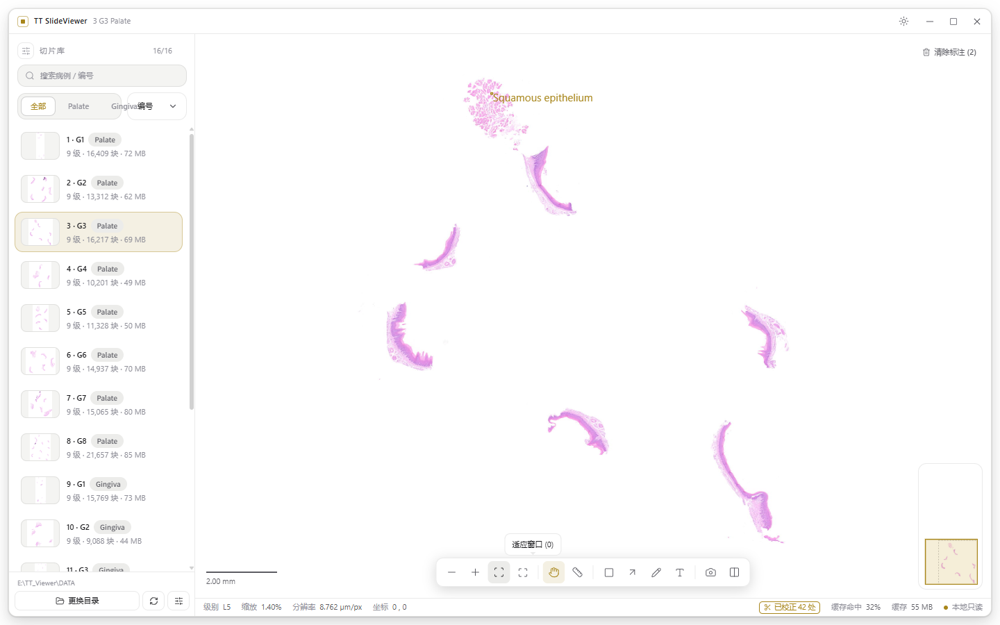
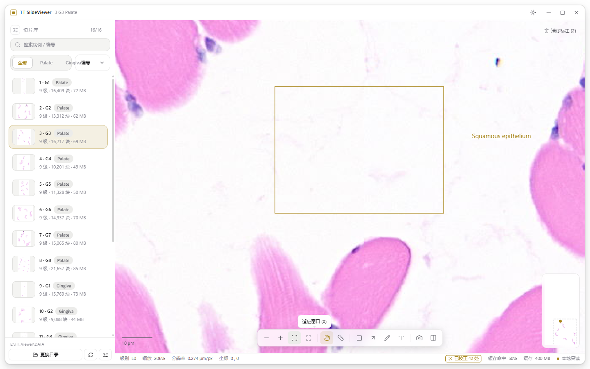
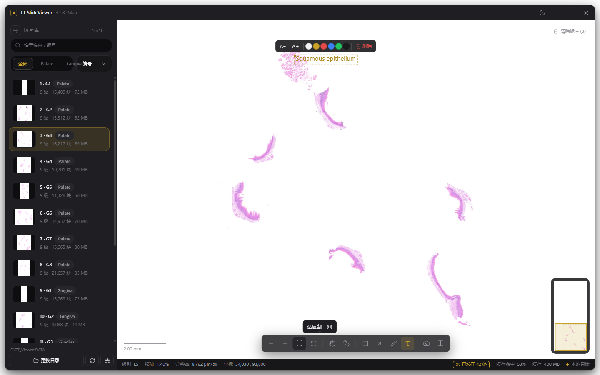
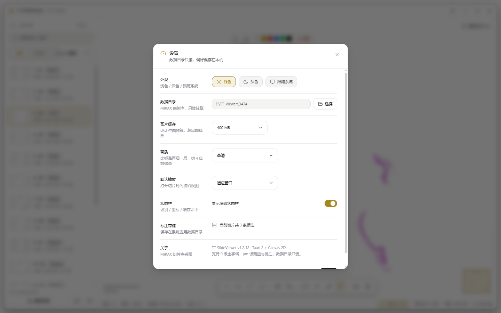
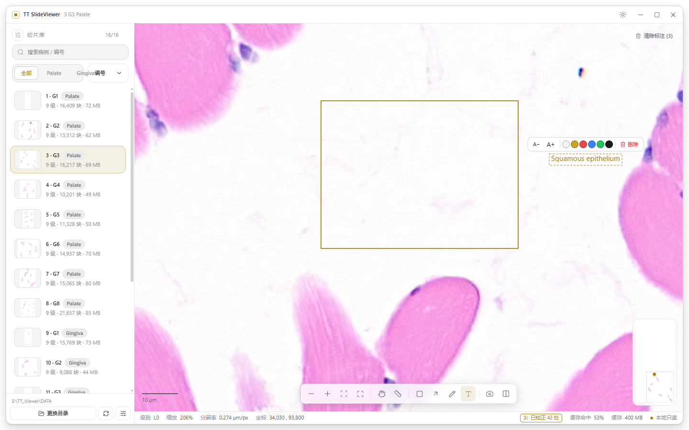
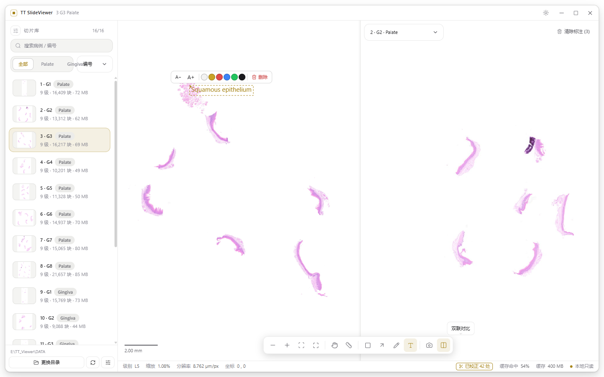

# TT SlideViewer

[中文文档](README.zh-CN.md)

A fast, offline Windows desktop viewer for **MIRAX (3DHISTECH Pannoramic) digital pathology slides** stored as raw `.dat` tile data. Built with **Tauri v2 + React**, it parses `Index.dat` directly, streams 303×253 JPEG tiles by coordinate, and renders a 9-level pyramid on a hand-rolled Canvas 2D engine — with automatic camera-photo stitch correction, µm-accurate measurement, persistent annotations and PNG export.

| Slide library | Deep zoom (L1, 0.55 µm/px) | Dark theme |
|---|---|---|
|  |  |  |

| Settings & image quality | Annotations | Dual-pane compare |
|---|---|---|
|  |  |  |

> **Installer size: 1.5 MB.** No backend process, no local HTTP server, no sidecar — closing the window is a full exit.

## Why another viewer?

The source slides come with a **broken `.mrxs` file** (its bytes are actually a renamed preview JPEG, starting `FF D8` instead of `MRXS`). OpenSlide/QuPath readers fail on it. This app ignores `.mrxs` entirely and reads the raw tile store instead. [OpenSeadragon] was also ruled out: it assumes a uniform square-tile grid, while MIRAX tiles are 303×253 and levels 0–4 are sparse — a custom Canvas engine keeps full control.

## Features

- **Automatic stitch correction** — background measurement of the scanner’s photo overlaps, then per-tile multi-segment cropping that removes the duplicated bands at every pyramid level (see below)
- **Slide library** — thumbnail per case, instant search, filter by site (palate/gingiva) and tooth (G1–G8)
- **Viewer** — wheel/double-click zoom anchored at the cursor, drag pan, automatic level switching with coarse-first fallback (no blank flashes)
- **Minimap** — bottom-right overview with a live viewport rectangle, click to jump
- **Measurement** — multi-point polyline with live µm/mm readout (`mpp × 2^level × px`), plus an adaptive scale bar
- **Annotations** — rectangle / arrow / freehand / text, persisted across restarts, undo and clear
- **PNG export** — current view or marquee region at the current level's native resolution
- **Dual-pane compare** — side-by-side cases with synced zoom/pan
- **Themes** — light / dark / follow system
- **Image quality** — standard / high (default) / ultra, controlling level-selection supersampling
- **Frameless window** — custom title bar, 8-direction resize hot zones, single instance, remembered geometry

## Getting started

### Install

Grab `TT SlideViewer_<ver>_x64-setup.exe` from [Releases] (NSIS, per-user, no UAC prompt) or build it yourself:

```bash
npm install
npm run release
# → src-tauri/target/release/bundle/nsis/TT SlideViewer_<ver>_x64-setup.exe
```

Requirements to build: Node.js ≥ 18, Rust stable (MSVC), Windows 10/11. The installer bootstraps WebView2 automatically on machines that lack it (requires internet once).

#### Versioning

`package.json` is the single source of truth for the version; `src-tauri/tauri.conf.json` points at it (`"version": "../package.json"`), and `src-tauri/Cargo.toml` is kept in sync automatically.

`npm run release` bumps the **patch** number *before* the bundler starts, so the installer file name always matches the build:

```bash
npm run release                          # 1.1.0 → 1.1.1 → 1.1.2 …
node scripts/bump-version.mjs set 1.2.0  # pin an exact version (next build ships 1.2.0)
node scripts/bump-version.mjs minor      # 1.2.0, or major
```

The bump has to happen before `tauri build` starts: Tauri resolves `tauri.conf.json` once, at launch, and the installer name comes from that snapshot. Running `npx tauri build` directly therefore builds the *current* version without incrementing it — use `npm run release` for shipping builds.

A version that has never shipped is left untouched by the bump, so a manually pinned version is not silently incremented before it reaches a user. The number is shown in **Settings → About**.

### Prepare data

The app mounts a **data root** folder — read-only, never modified:

```
DATA_ROOT/                     ← select this folder in the app
├─ Case 01 G1 Palate/          ← one folder per slide, any name
│  ├─ Index.dat                ★ required — tile index table
│  ├─ Slidedat.ini             scan parameters (µm/px)
│  └─ Data0000.dat … Data0021.dat   raw JPEG tile streams
├─ Case 02 G2 Palate/
└─ …
```

Rules of thumb:

- The app scans the **direct children** of the selected folder; a child counts as a slide iff it contains `Index.dat`.
- **ZIP archives are not mounted directly** — extract to a real folder first, then select the parent folder.
- `.mrxs` files are ignored (they are broken in this dataset and never read by the app).
- Slide folders must not be nested inside each other.
- The app **never writes to the data root** — settings, annotations and exports live in the app data directory and user-chosen paths.

Three ways to point the app at your data root (first match wins):

1. In-app: “Change folder” button or Settings dialog
2. `TT_SLIDE_DATA_ROOT` environment variable
3. Auto-detect: a `DATA/` folder next to the executable (up to 4 levels up) or in the working directory

The choice is persisted in `%APPDATA%\com.tt.slideviewer\settings.json` together with cache budget, default zoom and theme.

### Validate your data

```bash
cd src-tauri
cargo run --release --example validate -- <DATA_ROOT>
```

Parses every slide, checks the level pyramid and JPEG SOI/EOI markers, prints a per-slide table.

## Data format notes

Hard-won facts about this MIRAX flavor (validated against 16 slides / ~249k tiles), implemented in `src-tauri/src/index.rs`:

- `Index.dat`: 325-byte header, then 16-byte little-endian records — four `u32` fields in **two rotated layouts** (`[key, offset, length, fileno]` vs `[length, fileno, key, offset]`), decided per data file by counting which position holds a plausible `fileno`.
- The stored `length` is unreliable; lengths are recomputed from neighbouring offsets and trimmed at the EOI marker.
- **Level inference**: no fixed fileno→level table (it differs between slides). Instead the 2-adic valuation histogram of keys decides — level-k keys are multiples of 2^k, ~half of them not of 2^(k+1).
- **Coordinates**: `t = key >> level; x = t % 296; y = t / 296` — 296 is a fixed constant (`IMAGENUMBER_X`), **not** the per-level column count. Tile (x, y) at level k covers layer-0 pixels `[x·303·2^k, y·253·2^k]`.
- Levels 0–4 are **sparse** (only tissue tiles are stored); 5–8 are full rectangles. Tiles must be placed by (x, y), never by file order.
- µm/px comes from `Slidedat.ini` → `[LAYER_0_LEVEL_0_SECTION]` → `MICROMETER_PER_PIXEL_X`; level k resolution = value × 2^k.
- Level 0 is ~4.3 gigapixels (~12.8 GB uncompressed RGB) — compositing the whole slide is forbidden by design; tiles are streamed per viewport.
- **Photo-boundary overlap, not random tile noise.** `Slidedat.ini` records `CameraImageDivisionsPerSide = 8`: one camera photo is an 8×8 tile block, and saved tiles do not overlap (`IMAGE_OVERLAP_MICROMETERS_X/Y = 0`). Overlap exists only **between photographs** — the nominal `COMPRESSED_STITCHING_ORIG_CAMERA_TILE_OVERLAP_X/Y = 144` is where the camera intended to be, not where it actually was. Measured real overlap on this dataset is ~126–137 layer-0 px, always at `(index + 1) % 8 == 0`. A uniform grid therefore redraws a ~35 µm band; the viewer converts those boundaries to exact fractional positions and crops each duplicated run.

## Stitch correction

Each MIRAX camera photo is an 8×8 block of 303×253 JPEG tiles. Photos overlap by
~126–137 layer-0 px (~35 µm) at their edges only; the stored tiles do not overlap
(`IMAGE_OVERLAP_MICROMETERS_X/Y = 0`). A uniform tile grid therefore redraws that
band at every eighth boundary.

The app measures those boundaries in the background (~2–5 s) while the image is already
on screen, saves a single layer-0 table per slide, and reports the result in the
status-bar chip. Measurement is disabled until the geometry is known. Rendering converts
each boundary to an exact fractional position and draws every tile as multiple
`{s0,s1,d0,d1}` segments that omit the duplicated band; destination edges touch exactly,
so L4/L5 (several boundaries per stored tile) and level-to-level transitions stay
continuous. Per-tile translation is deliberately not used — it opens gaps on the
perpendicular tile grid (the 1.2.9 regression, now fixed).


## Architecture

One process, no sidecar:

```
┌───────────────────────────────────────────────┐
│  Tauri window (the only process)              │
│  WebView (React)           Rust core          │
│  ┌───────────────┐  invoke  ┌────────────────┐ │
│  │ Canvas engine  │ ───────► │ index parse    │ │
│  │ UI / annots    │ ◄─────── │ tile seek+read │ │
│  └───────────────┘  binary  └───────┬────────┘ │
└─────────────────────────────────────┼──────────┘
                                      ▼
                               DATA_ROOT/*.dat
```

- Tiles travel over `tauri::ipc::Response` as **raw bytes** (no base64): `[u32 count]{[u32 x][u32 y][u32 len][jpeg bytes]}*`, little-endian, ≤600 tiles per batch.
- The frontend decodes tiles into `ImageBitmap`s and keeps an LRU cache (default 400 MB budget, `bmp.close()` on evict).
- Renderer: dual canvas (tiles + annotation overlay), rAF + dirty-flag, DPR-aware backing store, coarse-ancestor fallback while zooming. Tiles are drawn as multiple source/destination segments that omit the photo-overlap bands (see Stitch correction).

## Keyboard shortcuts

| Key | Action |
|---|---|
| `+` / `=` · `-` / `_` | zoom in ×1.35 / out |
| `0` | fit slide to window |
| `F` | toggle fullscreen |
| `M` · `T` · `R` · `A` · `P` · `H` | measure · text · rectangle · arrow · pen · pan tool |
| `V` | toggle dual-pane compare |
| `↑` `↓` `←` `→` | pan (hold `Shift` for a bigger step) |
| `Ctrl`+`Z` / `Ctrl`+`Shift`+`Z` | undo / redo annotation |
| `Ctrl`+`S` | export the current view as PNG |
| `Esc` | cancel current action / deselect |
| `Delete` / `Backspace` | delete the selected annotation (or the last one) |

## Privacy

This repository does **not** contain any patient data. Case names in the screenshots are replaced with anonymous identifiers such as `3 · G3 Palate`; no clinical information or original slide names are committed.

## License

[MIT](LICENSE)

[OpenSeadragon]: https://openseadragon.github.io/
[Releases]: https://github.com/TTDiang2/TT_SlideViewer/releases
