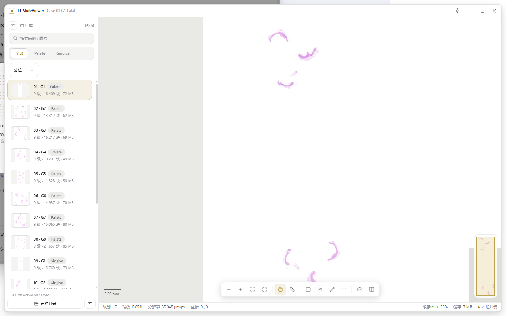
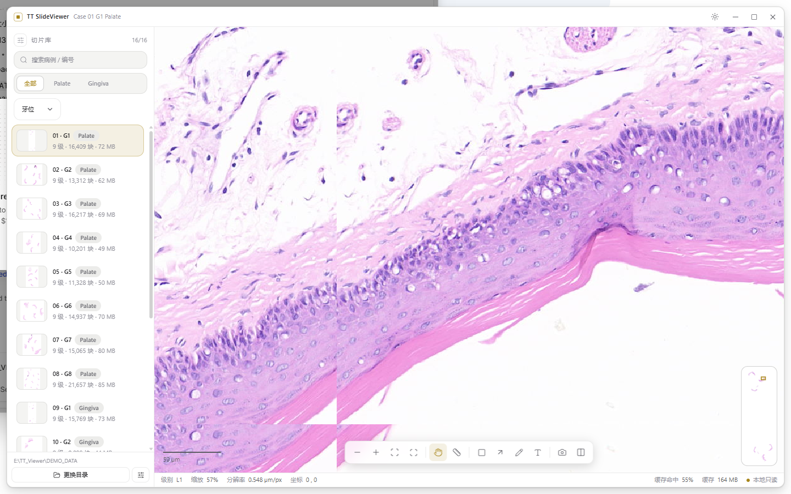
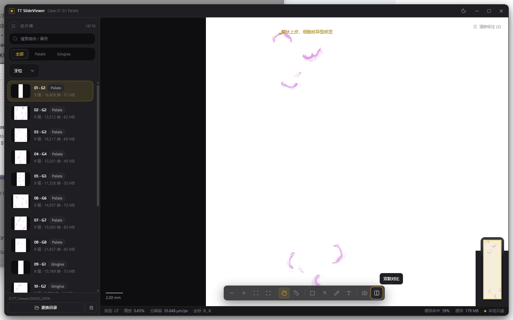
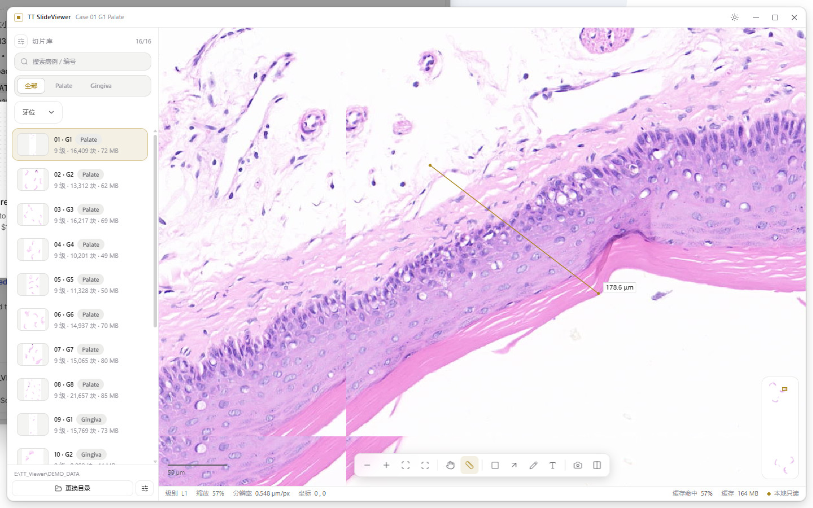
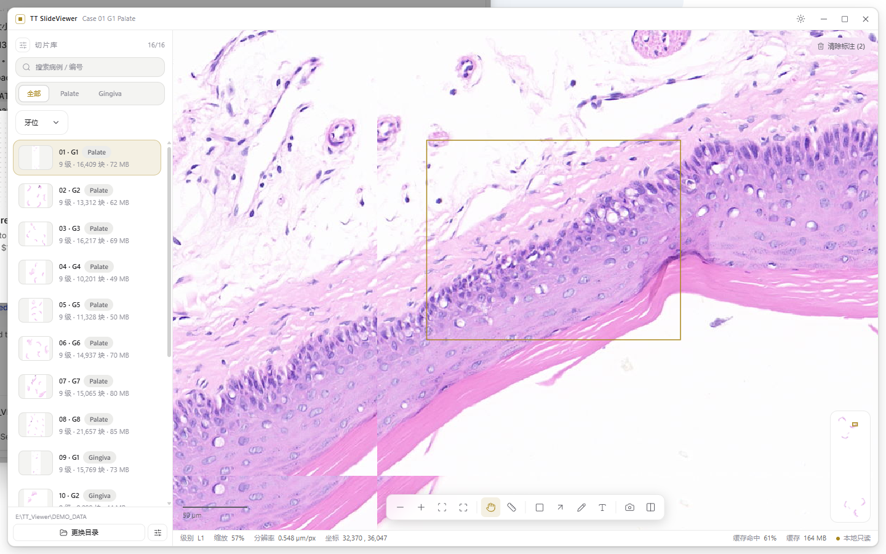
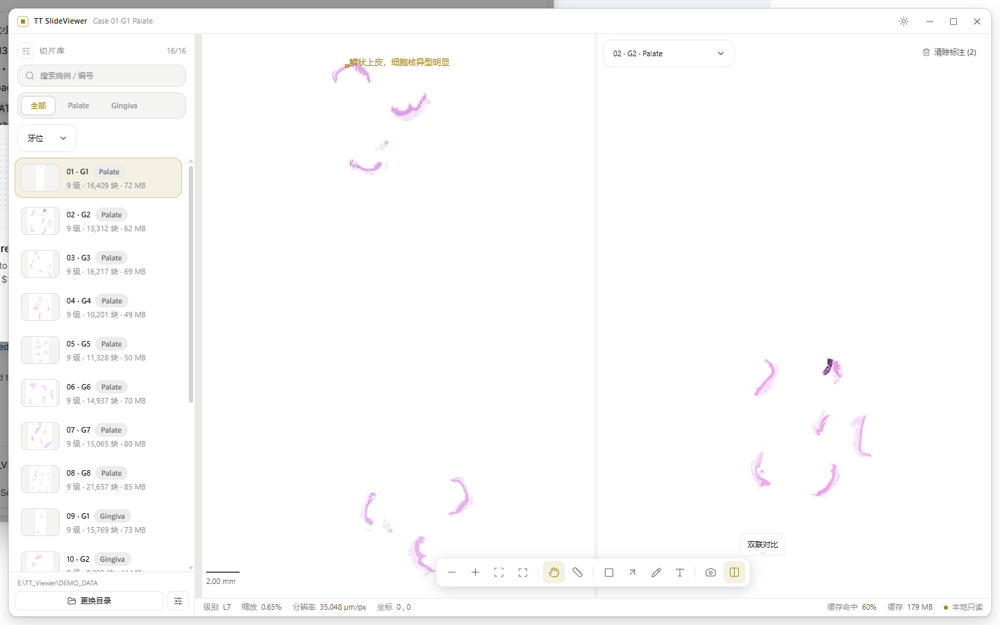

# TT SlideViewer

[English](README.md)

MIRAX（3DHISTECH Pannoramic）口腔病理切片的 Windows 桌面查看器。针对原始 `.dat` 瓦片数据（`.mrxs` 已损坏，见 3.2 节）直接解析 Index.dat、按坐标流式渲染 JPEG 瓦片，支持 9 级金字塔缩放、µm 级测距、标注持久化与 PNG 导出。

技术栈：Tauri v2 + React 19 + TypeScript + Vite 5 + Tailwind CSS + easyui（shadcn registry）+ Canvas 2D 自绘渲染器。**不引入 Python / 本地 HTTP 服务 / sidecar 进程**（硬性架构约束，见第 4 章）。

| 切片库 | 深度放大（L1，0.55 µm/px） | 深色主题 |
|---|---|---|
|  |  |  |

| 测距 | 标注 | 双联对比 |
|---|---|---|
|  |  |  |

> **安装包仅 1.5 MB。** 无后端进程、无本地端口、关窗即完全退出。

---

## 1. 快速开始

环境要求：Node.js ≥ 18、npm、Rust stable（msvc 工具链）、Windows 10/11（WebView2 运行时由安装包 downloadBootstrapper 兜底）。

```bash
npm install          # 安装前端依赖
npm run tauri dev    # 开发模式（Vite 热更新 + Rust 增量编译）
npm run tauri build  # 打包
```

打包产物（NSIS 安装器，`currentUser` 模式免 UAC，双击即装）：

```
src-tauri/target/release/bundle/nsis/TT SlideViewer_<版本>_x64-setup.exe
```

数据完整性自测（解析 DATA_ROOT 下全部病例，校验层级金字塔与 JPEG 首尾标记）：

```bash
cd src-tauri
cargo run --release --example validate -- <DATA_ROOT 路径>
```

---

## 2. 数据准备与 DATA_ROOT 配置

DATA_ROOT 是病例库根目录：**其直接子目录**中每个含 `Index.dat` 的文件夹被识别为一个病例。

```
DATA_ROOT/                     ← 软件里选择这一层
├─ Case 01 G1 Palate/          ← 每个病例一个文件夹（命名随意）
│  ├─ Index.dat                ★ 必需——瓦片索引表
│  ├─ Slidedat.ini             扫描参数（含 µm/px 标定）
│  └─ Data0000.dat … Data0021.dat   像素数据（连续 JPEG 瓦片流）
├─ Case 02 G2 Palate/
└─ …
```

要点：

- **ZIP 压缩包不能直接挂载**——先解压到磁盘上的真实文件夹，再选择病例文件夹的父级目录；
- `.mrxs` 文件会被忽略（本数据集里它是损坏的，应用从不读它）；
- 病例文件夹之间不得互相嵌套；
- **应用对数据目录严格只读**——设置、标注与导出只写入应用数据目录和用户明确选择的路径。任何情况下不得"修复/重命名/迁移" DATA_ROOT 里的文件。

三种配置方式（优先级从高到低）：

1. **应用内**：侧栏底部"更换目录"按钮或设置面板；
2. **环境变量** `TT_SLIDE_DATA_ROOT`；
3. **自动探测**：可执行文件向上 4 级父目录下的 `DATA/`，或工作目录（及其父目录）下的 `DATA/`。

配置持久化在 `%APPDATA%\com.tt.slideviewer\settings.json`：`root`、`cache_mb`（瓦片缓存预算，默认 400 MB）、`default_zoom`（`fit`/`actual`/`last`）、`theme`（`light`/`dark`/`system`）。

病例文件夹命名会自动解析出编号 / 牙位 / 部位用于列表展示与筛选：编号取名字里的纯数字段，牙位识别 `G<数字>`，部位识别 `腭` / `牙龈` / `Palate` / `Gingiva`。

---

## 3. 数据格式说明（重要）

以下事实已实测验证（16 例 / 约 24.9 万瓦片全量校验通过），接手前请通读，**不要尝试重新逆向**。

### 3.1 `.mrxs` 是假的，必须忽略

`.mrxs` 文件开头是 `FF D8`（JPEG 魔数）而非 `MRXS`——它只是预览图被改了名。**不要接入 OpenSlide / QuPath 的 MRXS 读取器，它们都会失败。** 本应用完全不读该文件。

### 3.2 Index.dat 解析要点

文件物理结构：**325 字节固定头**（`"01.02"` + 32 字节 slideId + 填充）+ 之后按 **2048 字节一页、每页 128 条、每条 16 字节** 组织。每条 = 4 个 uint32 小端。（实现上按连续 16 字节记录读取即可，页边界无影响。）

**条目有两种字段布局（字段互为旋转）：**

| 布局 | 字段顺序 |
|---|---|
| A | `(key, offset, length, fileno)` |
| B | `(length, fileno, key, offset)` |

按 data 文件为单位投票判定布局：统计第 4 字段 / 第 2 字段等于该 fileno 的条目数，多者为该文件的实际布局。不要写死"奇数文件 A、偶数文件 B"。

**层级判定**：不依赖固定映射表（各病例可能不同），由 key 的 2-adic valuation（key 中因子 2 的个数）直方图推断——level-k 的 key 必是 `2^k` 的倍数，且约半数不是 `2^(k+1)` 的倍数，取直方图峰值下界。1 号病例实测结果恰为 `5→0, 7→1, 8→2, 9→3, 10→4, 11→5, 12→6, 13→7, 14→8`。

**坐标解码（全片最关键一步）**：

```
t = key >> level
x = t % 296        // 296 是固定常量（Slidedat.ini 的 IMAGENUMBER_X），
y = t / 296        // 不是"本层列数"，绝不能换成 max(x)+1
```

瓦片统一 **303 × 253** JPEG；层 k 的瓦片 (x, y) 覆盖 0 层像素 `[x·303·2^k, y·253·2^k]`，各层天然对齐，全部换算到"0 层坐标系"这一虚拟画布再映射。

**其余校验与容错**（实现在 `src-tauri/src/index.rs` 与 `slide.rs`）：

- 条目中的 `length` 字段不可靠（描述的是上一片），实际长度由相邻 offset 差重算，读取时以 `FF D9`（EOI）截断；
- 采样最多 20 个 offset、每处 4 KB 探针验证 `FF D8 FF`（SOI）；若存在固定小漂移（≤ 8 KB，个别文件头被截断所致）则整体修正；
- 非瓦片库的 dat（预览图、XML、直方图）因 SOI 命中率不足被自动剔除；
- `Slidedat.ini` 只读一个字段：`[LAYER_0_LEVEL_0_SECTION]` 的 `MICROMETER_PER_PIXEL_X`（缺省 0.273809523809524）。层 k 的 µm/px = 该值 × 2^k，用于测距与比例尺。

### 3.3 层级表（1 号病例实测基准）

| level | 瓦片数 | x 范围 | y 范围 | 层像素尺寸 |
|---|---|---|---|---|
| 0 | 9983 | 80–199 | 128–591 | 36360 × 117392 |
| 1 | 3584 | 40–103 | 64–295 | 19392 × 58732 |
| 2 | 1471 | 16–55 | 32–151 | 12120 × 30360 |
| 3 | 704 | 8–31 | 16–79 | 7272 × 16192 |
| 4 | 383 | 0–15 | 8–39 | 4848 × 8096 |
| 5 | 192 | 0–7 | 0–23 | 2424 × 6072 |
| 6 | 64 | 0–4 | 0–12 | 1515 × 3289 |
| 7 | 21 | 0–2 | 0–6 | 909 × 1771 |
| 8 | 7 | 0–1 | 0–3 | 606 × 1012 |

**0–4 层稀疏**（只存有组织内容的瓦片，大量空白不存），**5–8 层完整矩形**。因此必须按 (x, y) 定位放置，绝不能按文件内瓦片先后顺序依次铺。其他病例瓦片数允许 ±2 偏差；超出 ±5 视为数据异常。

### 3.4 为什么不能拼整图

0 层约 **42.7 亿像素**（36360 × 117392），未压缩 RGB 约 **12.8 GB**——任何"先拼全景大图再显示"的做法都会内存爆炸。正确做法：瓦片本就是现成 JPEG，按视口所需坐标范围取出原样透传给前端流式渲染。同理，本应用明确不做全片拼接导出。

---

## 4. 架构

**没有独立后端进程**：不开 HTTP 服务、不占端口、不起 sidecar。关窗 = 进程退出 = 一切结束。所有磁盘 I/O 在 Rust 侧完成，前端不申请 `fs` 权限（`capabilities/default.json` 只授予窗口、dialog、opener、window-state 的必要权限）。

```
┌───────────────────────────────────────────────┐
│  Tauri 窗口（唯一进程）                         │
│  WebView (React)           Rust Core           │
│  ┌───────────────┐  invoke  ┌────────────────┐ │
│  │ Canvas 渲染器   │ ───────►│ 索引解析/缓存    │ │
│  │ UI / 标注      │ ◄─────── │ 瓦片 seek+read │ │
│  └───────────────┘  二进制   └───────┬────────┘ │
└──────────────────────────────────────┼─────────┘
                                       ▼
                                DATA_ROOT/*.dat
```

**瓦片走 `tauri::ipc::Response` 返回裸字节（不 base64，省 33% 带宽与一次编解码）。** 批量帧格式（全部小端）：

```
[u32 tile_count]
repeat tile_count:
  [u32 x][u32 y][u32 byte_len][byte_len 字节 JPEG]
```

一次缩放可能需要 40–80 片，批量返回可将 IPC 往返压到每帧一次（单次上限 600 片，前端另有 40 ms 节流与 in-flight 去重）。

**前端缓存**：瓦片解码为 `ImageBitmap`（`createImageBitmap`，解码不占主线程），存全局 `TileCache`（`src/lib/tileCache.ts`）LRU 淘汰，预算默认 400 MB（设置中可选 128–2048 MB），淘汰时调用 `bmp.close()` 真正释放 GPU 内存。

**IPC 命令清单**（`src-tauri/src/commands.rs`）：

| 命令 | 说明 |
|---|---|
| `list_slides(root)` | 扫描 DATA_ROOT，返回病例元信息（按序号排序） |
| `warm_slides(ids)` | 后台预解析，打开切片零等待 |
| `slide_info(id)` | 各层 bbox / 像素尺寸 / µm/px |
| `get_tiles(id, level, x0, y0, x1, y1)` | 批量取瓦片，返回上述二进制帧 |
| `slide_thumb(id, kind)` | 小地图 / 列表缩略图（粗层 RGBA 合成，`[u32 w][u32 h][RGBA]`） |
| `default_root()` | DATA_ROOT 自动探测 |
| `save_export(path, bytes)` | 导出 PNG 落盘（base64 传输，用户选择路径） |
| `load_annotations` / `save_annotations` | 标注读写（应用数据目录 `annotations.json`，写入前 JSON 校验） |
| `load_settings` / `save_settings` | 设置读写（应用数据目录 `settings.json`） |

渲染器要点（`src/components/ViewerCanvas.tsx`，双 canvas：瓦片层 + 标注 overlay 层）：

- 视口 `{scale, tx, ty}`，scale = 屏幕像素 / 0 层像素；自动切层 `k = clamp(round(-log2(scale)), 0, 8)`，就近取实际存在的层；
- 目标层瓦片未到位时回退绘制已缓存的粗层祖先（低清先出，不闪空白格）；缺失瓦片以画布底色填充，不闪白；
- 预取：视口外扩 2 片，同时保持 k+2 粗层热备；
- `requestAnimationFrame` + 脏标记驱动，静止不重绘，单帧绘制异常不中断渲染循环；
- backing store 按 `devicePixelRatio` 放大（上限 2.5），高 DPI 不发虚；瓦片边缘坐标取整对齐，消除接缝；
- 缩放锚点跟随鼠标位置（滚轮 / 双击均如此）。

---

## 5. 功能清单

- **病例列表**：缩略图 + 名称，关键字搜索，按部位标签页与牙位（G1–G8）下拉筛选；
- **查看器**：滚轮 / 双击缩放（鼠标为锚点）、拖拽平移、自动切层、切层无跳变（低清先出）；
- **导航小地图**：右下角全片缩略 + 视野框，点击跳转；
- **测距**：折线多点测量，实时显示 µm / mm（`mpp × 2^k × px`）；另有自适应比例尺（1/2/5 × 10ⁿ）；
- **标注**：矩形 / 箭头 / 自由绘制 / 文字，持久化到应用数据目录（重启仍在），可逐条撤销或整片清除；
- **PNG 导出**：当前视野或框选区域，按当前层级 1:1 像素导出，文件名 `{病例号}-{牙位}-{部位}_L{层级}_{x}_{y}.png`；
- **双联对比**：左右并排（可拖动分隔条），右侧病例可切换，缩放平移同步（视野中心按比例映射）；
- **状态栏**：当前层级、缩放倍率、鼠标 0 层坐标、缓存命中率与占用量（可开关）；
- **主题**：浅色 / 深色 / 跟随系统；
- **窗口**：无边框 + 自绘标题栏（拖拽、双击最大化、Win11 贴边分屏）、8 方向边缘缩放热区、单实例（二次启动激活已有窗口）、窗口尺寸位置记忆。

明确不做（会 OOM 或超出范围）：全片拼接导出、多通道荧光、Z-stack、云端上传、AI 分析。

---

## 6. 快捷键

输入框聚焦或按住 Ctrl/Cmd 时快捷键不生效。

| 按键 | 功能 |
|---|---|
| `+` / `=` | 放大（×1.35） |
| `-` / `_` | 缩小（÷1.35） |
| `0` | 适应窗口（回到整片视野） |
| `F` | 全屏切换 |
| `M` | 进入 / 退出测距模式 |
| `T` | 切换浅色 / 深色主题 |
| `Esc` | 取消（框选、文字输入、测量进行中、设置面板，回到平移工具） |
| `Delete` / `Backspace` | 撤销上一条标注 |

---

## 7. 目录结构

```
tt-slideviewer/
├─ README.md                    # 英文文档
├─ README.zh-CN.md              # 中文文档（本文件）
├─ LICENSE
├─ docs/screenshots/            # README 截图（匿名演示数据）
├─ package.json
├─ vite.config.ts
├─ tailwind.config.js / postcss.config.js
├─ components.json              # shadcn / easyui registry 配置
├─ index.html / app-icon.png
├─ src/
│  ├─ main.tsx
│  ├─ App.tsx                   # 应用骨架：设置加载、快捷键、导出、标注、双联
│  ├─ components/
│  │  ├─ TitleBar.tsx           # 自绘标题栏（最小化/最大化/关闭、主题切换、拖拽区）
│  │  ├─ ResizeHandles.tsx      # 无边框窗口 8 方向缩放热区
│  │  ├─ ViewerCanvas.tsx       # Canvas 渲染器 + 测量/标注 overlay
│  │  ├─ SlideList.tsx          # 病例列表（搜索/部位/牙位筛选）
│  │  ├─ Minimap.tsx            # 导航小地图
│  │  ├─ ToolBar.tsx            # 浮动工具栏
│  │  ├─ StatusBar.tsx          # 状态栏
│  │  ├─ SettingsDialog.tsx     # 设置面板
│  │  ├─ SplitPane.tsx          # 双联对比分栏
│  │  └─ ui/                    # easyui（shadcn registry）copy 进来的组件
│  │     Button / Badge / Skeleton / SpringSelect / AnimatedTabs
│  │     CompactSearchBar / DirectionalTooltip / Form / MorphingDialog
│  │     OriginDropdown / PressButton / StretchSwitch / VelocityToast
│  ├─ hooks/useSlide.ts         # 病例列表 / 切片信息 / 标注持久化（防抖保存）
│  ├─ lib/
│  │  ├─ coords.ts              # 层级选择与坐标换算（全部收敛在此）
│  │  ├─ ipc.ts                 # invoke 封装 + 二进制帧解析
│  │  ├─ tileCache.ts           # ImageBitmap LRU 缓存
│  │  ├─ theme.ts               # 浅/深/跟随系统主题
│  │  ├─ motion-tokens.ts / types.ts / utils.ts
│  └─ styles/theme.css          # 设计 token（浅/深两套 CSS 变量）
└─ src-tauri/
   ├─ Cargo.toml                # release: lto + opt-level "s" + strip
   ├─ tauri.conf.json           # 无边框窗口 + CSP + NSIS 打包配置
   ├─ build.rs
   ├─ capabilities/default.json # 最小权限（无 fs）
   ├─ icons/
   ├─ examples/                 # 数据完整性校验 / 缩略图调试 CLI
   └─ src/
      ├─ main.rs / lib.rs       # 入口、插件注册、命令表
      ├─ index.rs               # Index.dat 解析（层级推断、坐标解码、SOI 探针）
      ├─ slide.rs               # 切片抽象：句柄懒开、EOI 截断读取、缩略图合成
      └─ commands.rs            # IPC 命令
```

---

## 8. 开发注意（踩坑记录）

1. 不要用 OpenSeadragon——瓦片是 303×253 非方形且 0–4 层稀疏缺片，等大正方形网格假设必然错位；
2. 不要用"偏移处是 FFD8"反推 fileno——大文件随机偏移极易撞上 JPEG 头，必须靠条目内 fileno 字段 + 投票；
3. 不要按瓦片在文件中的先后顺序铺图——稀疏层会得到"看似连贯但比例拉伸"的错图；
4. 不要建全尺寸画布 / 不要尝试拼整图（见 3.4）；
5. CSP 必须放行 `ipc:` 与 `blob:`（见 `tauri.conf.json`），否则 invoke 静默失败或瓦片渲染不出；
6. 中文 + 空格路径：前端一律传目录绝对路径 `id`，不做 URL 编码；
7. `transparent + decorations:false` 会失去系统原生边缘缩放，8 个热区（`ResizeHandles.tsx`）不可删；最大化时须去掉圆角与阴影，否则四角露透明缝；
8. 目标机器无 WebView2 时由 NSIS `downloadBootstrapper` 兜底安装（需联网一次）；
9. 自定义 CSS 必须收进 Tailwind 的 `@layer components`——无层 CSS 会按源顺序压过 utilities 层（曾经把画布定位压塌成 0 高）；
10. 大字节 IPC：瓦片下行用 `tauri::ipc::Response` 裸字节；PNG 导出上行用 base64 字符串——`Array.from` 成 JSON 数字数组会让 IPC 卡顿数秒。

---

## 隐私声明

本仓库不含任何患者数据；README 截图均摄自匿名化演示目录，未提交任何临床信息或真实切片命名。

## 许可证

[MIT](LICENSE)
